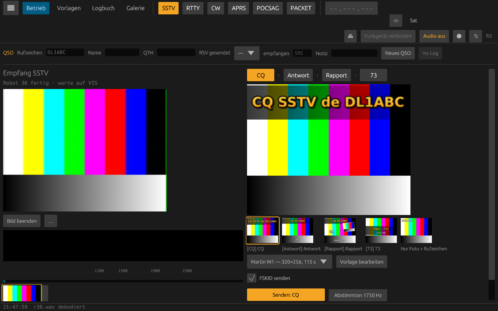
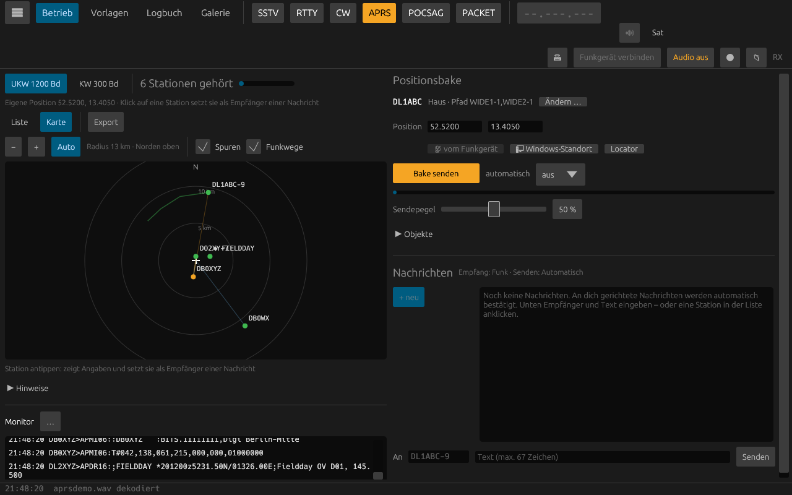
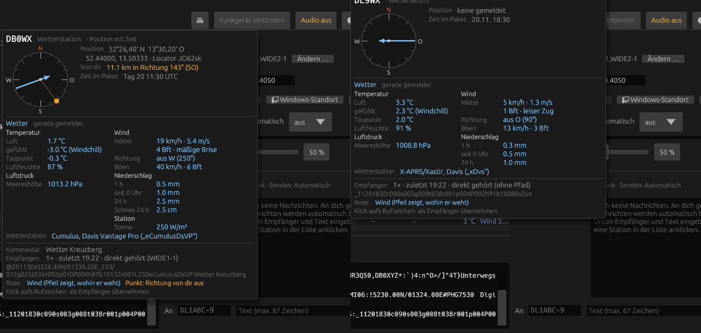
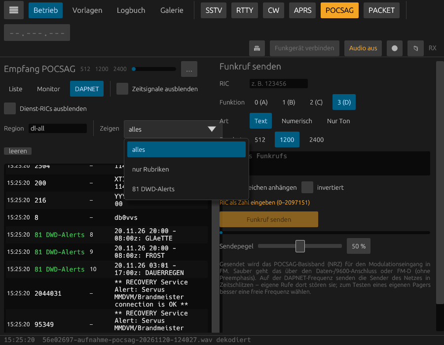
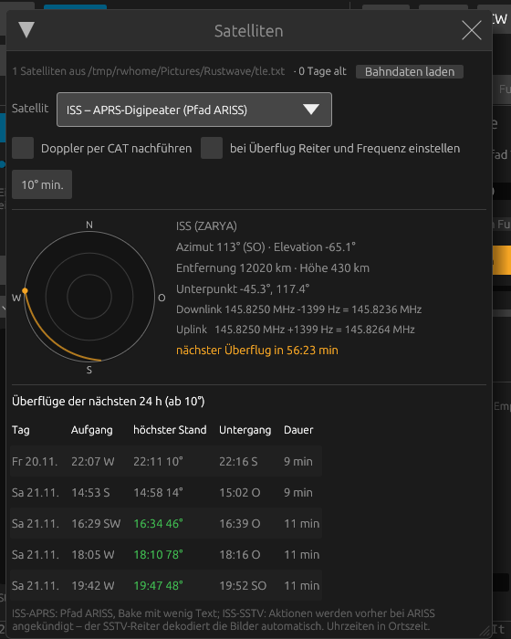

<b>SSTV · RTTY · CW · APRS · POCSAG/DAPNET · Packet Radio · Satelliten</b> 
Ein Programm für die digitalen Betriebsarten im Amateurfunk – mit CAT-Steuerung und kabellos über das WLAN des Icom IC-705.

*[English summary below](#english-summary)*

Rustwave ist eine eigenständige Anwendung in Rust: eine einzige `.exe`, ohne Installation, ohne Browser und ohne zusätzliche DLLs. Sie dekodiert und sendet SSTV-Bilder, RTTY, CW, APRS, POCSAG-Funkrufe und Packet Radio, steuert das Funkgerät per CAT und kann das Icom IC-705 vollständig über WLAN bedienen – Steuerung, Audio in beide Richtungen, Sendetaste und GPS.

> [!IMPORTANT]
> **Getestete Funkgeräte:** Die Funkgerätesteuerung (CAT, Audio, PTT) ist bisher nur mit dem **Icom IC-705** (über WLAN und USB) und dem **Icom IC-7300** (über USB) getestet und verifiziert. Die übrigen über 30 vorkonfigurierten Geräte von Icom, Yaesu, Kenwood und Elecraft sind nach den Protokollbeschreibungen der Hersteller umgesetzt, aber ungetestet. Rückmeldungen mit anderen Geräten sind sehr willkommen – siehe [Gerätetest melden](.github/ISSUE_TEMPLATE/geraetetest.md).

## Besonderheit: IC-705 komplett über WLAN

Rustwave spricht das (nicht offengelegte) Netzwerkprotokoll von Icom selbst. Ein USB-Kabel ist nicht nötig:

- **Steuerung, Empfangs- und Sendeaudio sowie PTT** laufen über das WLAN – im Heimnetz oder direkt mit dem IC-705 als Access Point (Rustwave richtet das Windows-WLAN-Profil selbst ein).
- **GPS über WLAN:** Position und Uhrzeit des IC-705 kommen auch drahtlos an. Damit funktioniert APRS-Tracking mit SmartBeaconing (Kurs, Tempo, Höhe) ohne Kabel.
- **ZF-Ausgang automatisch:** Für POCSAG, APRS und Packet über FM schaltet Rustwave den Audioausgang des IC-705 auf die 12-kHz-ZF und demoduliert FM selbst – ohne Deemphasis und Tiefenfilter des Geräts dekodiert das deutlich mehr. Für SSTV, RTTY und CW stellt es wieder NF ein.
- **Verlustbehandlung:** Fehlende Audiopakete werden nachgefordert und sortiert, Verbindungsabbrüche automatisch wiederhergestellt.
- **Sprechfunk am PC:** Mithören über den PC-Lautsprecher und Senden mit dem PC-Mikrofon (Leertaste), ebenfalls über WLAN.
- **TNC für andere Programme:** Über KISS/AGW nutzen Winlink Express, YAAC, APRSIS32 & Co. das IC-705 drahtlos über Rustwave.

Einrichtung Schritt für Schritt: **[docs/IC-705-WLAN.md](docs/IC-705-WLAN.md)**

## Funktionen

| Bereich | Was Rustwave kann |
|---|---|
| **SSTV** | 23 Modi (Martin, Scottie, Robot, PD, Wraase, Pasokon, S/W), Senden und Empfang mit VIS-Erkennung und Slant-Korrektur, Vorlagen-Editor mit QSO-Makros, Bild im Bild, FSKID wie MMSSTV, Galerie |
| **RTTY / CW** | Baudot 45,45/50/75 Bd; CW-Empfang 5–60 WpM mit Skimmer (bis 10 Signale gleichzeitig), CW-Senden |
| **APRS** | 1200 Bd UKW und 300 Bd KW, Karte mit Spuren und Funkwegen, Stationskarte mit Kompassrose, Wetter (gegliedert, mit Verlauf), Telemetrie, Mic-E, Objekte, Nachrichten, Bulletins, iGate, SmartBeaconing mit GPS, Hinweise/Alarme, Abfragen, GPX/KML-Export, KW-Skimmer |
| **POCSAG / DAPNET** | 512/1200/2400 Bd mit allen Ausgabemodi von multimon-ng, Fehlerkorrektur, DAPNET-Ansicht mit Rubriken (Liste von pi-star.de), Skyper-Entschlüsselung, Zeitsignale/Dienst-RICs ausblendbar, gehörte Sender mit Pegel, Ruf ins Netz über hampager.de, Betrieb als DAPNET-Sender (UniPager-Protokoll) |
| **Packet Radio** | AX.25 2.0 mit Verbindungen, 300/1200 Bd AFSK und 9600 Bd G3RUH, Terminal und Monitor |
| **Satelliten** | Bahndaten von CelesTrak/AMSAT/SatNOGS, Überflüge, Himmelskarte, Doppler-Nachführung per CAT, ISS-Voreinstellungen (APRS, SSTV, Sprechfunk) mit änderbaren Frequenzen |
| **Funkgerät** | CAT für Icom (CI-V), Yaesu, Kenwood, Elecraft; Frequenz/Mode/Leistung, S-Meter und Sendemesswerte, Spektrum und Wasserfall vom Gerät, Tuner, Profile |
| **Drumherum** | Logbuch mit ADIF, TNC (KISS/AGW), Sprechfunk, Aufnahme/WAV-Dekodierung, Selbsttest, Touch-Bedienung, GPS-Zeit |

## Bilder

| | |
|---|---|
|  |  |
| APRS-Karte mit Spuren und Funkwegen | Stationskarte einer Wetterstation |
|  |  |
| DAPNET-Rubriken (echter Empfang über die ZF des IC-705) | Satellitenfenster (Beispielbahndaten) |

Weitere Bilder liegen in [`docs/images`](docs/images).

## Installation

**Windows:** Unter [Releases](../../releases) die aktuelle `rustwave-…-windows-x64.zip` laden, entpacken und `rustwave.exe` starten. Windows SmartScreen warnt beim ersten Start, weil die Datei nicht signiert ist: „Weitere Informationen“ › „Trotzdem ausführen“.

**Linux:** selbst bauen, siehe [docs/BAUEN.md](docs/BAUEN.md).

## Erste Schritte

1. **Einstellungen › Station:** Rufzeichen, Name, QTH, Locator.
2. **Einstellungen › Audio:** Ein- und Ausgang des Funkgeräts (z. B. „USB Audio CODEC“) – entfällt bei WLAN.
3. **Einstellungen › Transceiver:** Gerät und Verbindung (USB/seriell oder WLAN/LAN), dann *Verbinden*.
4. Betriebsart oben wählen (F1 SSTV, F2 RTTY, F3 CW, F4 APRS, F9 POCSAG, F10 Packet) – Rustwave stimmt das Funkgerät auf die zuletzt benutzte Frequenz der Betriebsart ab.
5. Sendepegel mit dem Abstimmton so einstellen, dass die ALC gerade nicht anschlägt.

Alles Weitere steht im **[Handbuch](docs/HANDBUCH.md)**.

## Dokumentation

- [Handbuch](docs/HANDBUCH.md) – alle Funktionen im Detail
- [IC-705 über WLAN](docs/IC-705-WLAN.md) – Einrichtung, Access Point, ZF, GPS, Fehlersuche
- [Selbst bauen und testen](docs/BAUEN.md)
- [Änderungen](CHANGELOG.md)
- [Verwendete Bibliotheken und Lizenzen](docs/THIRD-PARTY.md)
- [Mitmachen](CONTRIBUTING.md)

## Hinweise zum Sendebetrieb

Senden ist nur mit gültiger Amateurfunkgenehmigung erlaubt. Beim automatischen Senden (Baken, Digipeater-Antworten, DAPNET-Sender, Abfragen) gelten die Regeln deines Landes; ein Betrieb ohne Aufsicht ist in Deutschland eine automatisch arbeitende Station und braucht eine eigene Zuteilung. Die Nutzung erfolgt auf eigene Verantwortung und ohne Gewährleistung (siehe Lizenz).

## Lizenz

Rustwave ist freie Software unter der **GNU General Public License, Version 3 oder später** ([LICENSE](LICENSE), SPDX: `GPL-3.0-or-later`). Du darfst es nutzen, verändern und weitergeben; abgeleitete Programme müssen ebenfalls unter der GPL veröffentlicht werden.

Enthaltene fremde Bestandteile: Schrift DejaVu ([Lizenz](assets/DejaVu-LICENSE.txt)), Icom-Netzwerkprotokoll nach kappanhang ([MIT](assets/kappanhang-LICENSE.txt)), Rust-Bibliotheken unter MIT, Apache-2.0 und verwandten Lizenzen ([Liste](docs/THIRD-PARTY.md)).

## Autor

**Roman Ewert, DL4RE**

## Dank

- **kappanhang** (HA2NON, ES1AKOS) und **wfview** – Vorbild für das Icom-Netzwerkprotokoll
- **multimon-ng** – Vorbild für den POCSAG-Dekoder und Vergleichsdekoder
- **Dire Wolf** (WB2OSZ) – Vergleich für APRS/Packet und KISS
- **UniPager** und das **DAPNET-Team** (RWTH Aachen) – DAPNET-Protokoll
- **pi-star.de** – Liste der DAPNET-Rubriken
- **slowrx, MMSSTV, QSSTV, PySSTV** – SSTV-Modusbeschreibungen und Vergleichsaufnahmen
- **CelesTrak, AMSAT, SatNOGS** – Bahndaten
- **egui/eframe, cpal, sgp4** und alle weiteren Rust-Bibliotheken

---

## English summary

**Rustwave** is a standalone amateur radio application written in Rust for **SSTV, RTTY, CW, APRS, POCSAG/DAPNET, AX.25 packet radio and satellite work**, with CAT control for common transceivers. A single Windows `.exe`, no installer, no extra DLLs; Linux builds from source.

Its special feature is **full wireless operation of the Icom IC-705 over WLAN** using Icom's network protocol: CAT, receive and transmit audio, PTT and GPS (position and time) – including access-point mode, automatic switching of the IC-705's 12 kHz IF output for FM data modes (with FM demodulation in software), PC voice operation, and a KISS/AGW TNC server so other programs (Winlink Express, YAAC, APRSIS32, …) can use the radio wirelessly.

Further highlights: APRS map with tracks, radio paths, weather, telemetry, Mic-E, objects, SmartBeaconing with GPS, alerts and GPX/KML export; POCSAG decoder modelled on multimon-ng with a DAPNET view (rubrics, Skyper decoding, heard transmitters), DAPNET API and DAPNET transmitter mode (UniPager protocol); satellite pass prediction with Doppler correction and ISS presets.

> **Tested radios:** rig control has so far only been tested and verified with the **Icom IC-705** (WLAN and USB) and the **Icom IC-7300** (USB). Other preconfigured radios are untested – reports are welcome.

The user interface and documentation are in German. Licensed under **GPL-3.0-or-later**. Author: **Roman Ewert, DL4RE**.
